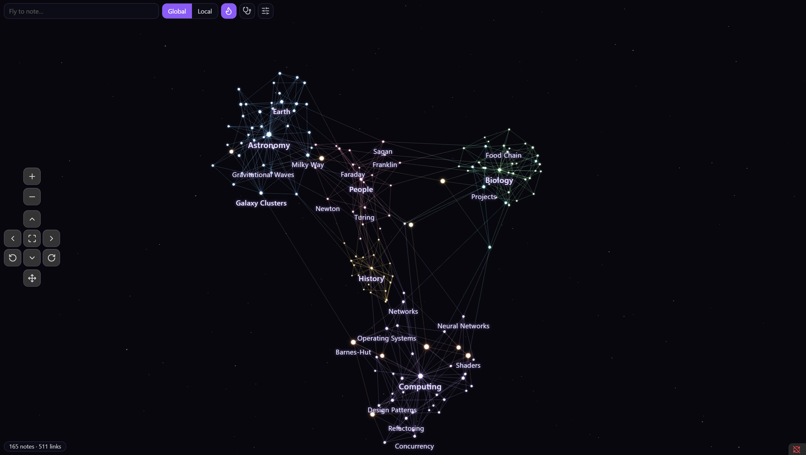
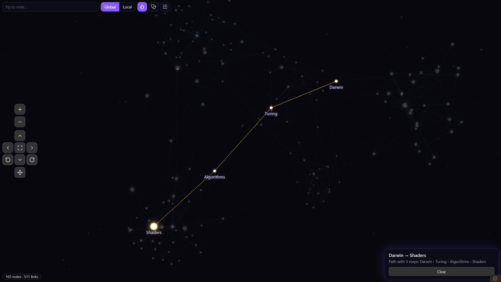
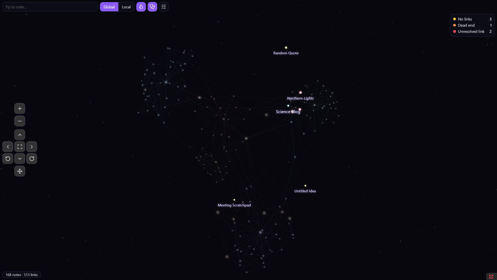
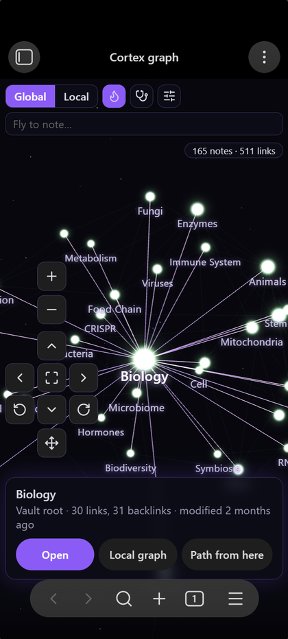

# Cortex Graph

A 3D graph view for Obsidian with glowing nodes – made for exploring a large vault, not just looking at it.
Works on **desktop and mobile** (touch controls included).



## Features

- **3D or flat layout** with glowing nodes, deep-space or theme background, light and dark mode.
- **Live updates** – new notes and links appear immediately, the layout stays stable.
- **Native Obsidian integration**
  - click to select and highlight neighbours, double-click (or Ctrl/Cmd-click) to open
  - hover preview (Page preview core plugin, with Ctrl/Cmd by default)
  - right-click shows the normal file menu
- **Local graph** that follows the active note (depth 1–3), also in the sidebar.
- **Explorer hover** – hovering a file in the file explorer lights up its node, hovering a folder lights up all notes inside.
- **Time lapse and tag filter** – watch your vault grow by creation date, modification date or any date property; limit the time range, filter by tag, set the speed (1 s = 1 minute / hour / day / week / month).
- **Video export** – REC button records the time lapse with names and date caption; afterwards preview it and choose *Save as…*, *Save in vault* or *Discard* (or save automatically, see settings).
- **Saved views** – store camera, mode, filters and time range under a name and bring them back with one click.
- **Folder galaxies** – hovering or opening a folder in the explorer shows a glowing cloud with the folder name.
- **Keep folders together** – notes are tied to their folder (invisible or as thin lines), so notes without links stay with their folder.
- **Tooltip** on hover with folder, links, backlinks, tags and last change.
- **Hide folders** – right-click a folder → *Hide in graph*.
- **Activity heat** – recently edited notes glow warmer and pulse, so you see at a glance where work is happening.
- **Shortest path** between two notes – pick "Path from here", then the target. Also available as a command.
- **Fly-to search** – type a name, the camera flies to the note.
- **Link health check** – notes without links, dead ends and unresolved links are colored, with counts.
- **Link suggestions** – inside the link check: notes that mention another note's name or alias without linking it are marked; select one to see dashed suggestion lines and link with one click.
- **Create and link in the graph** – right-click empty space for a new note, right-click a node for a new linked note, Shift + drag from one node to another to add a link.
- **Live activity** – notes changed outside the editor (e.g. by an AI agent via MCP or CLI) flash orange; tools can also log reads/writes to `.cortex/activity.jsonl` (`{"op":"read","path":"..."}` per line) to make reads visible.
- **Review** – highlight notes changed today, since Obsidian started, in the last 7 days or externally.
- **Faded corners** – notes untouched for a configurable number of days get paler and smaller.
- **Controls** – keyboard and mouse bindings shown and editable in the panel (two keys per action, drag buttons, wheel direction, rotation speed).
- **Base form** – keep the whole graph inside a sphere, pyramid (one base corner per top-level folder, core at the apex), cube or a brain (side view), with top-level folders gathered in their own regions (brain: one lobe per folder, biggest folder frontal).
- **Labels** – choose the font and a glow, shadow or background in the note's folder color.
- **Look** – glowing nodes with separate sliders for node brightness (intensity) and glow (radius); thin lines with their own brightness.
- **Node shapes** – circle, ring, star, diamond, square: per folder or note (right-click → Appearance…, also sets weight), via the `form` property, or automatically by importance with a percentage slider per shape.
- **Camera focus** – a click flies to the note; a click on empty space returns to the previous view.
- **Automatic priority** – names and font sizes follow the importance of a note, not just its link count: links across projects and areas count fully, links inside one project (e.g. chapters of a split document) only a little. A `priority` property (1–5 or low/medium/high) and folder weights refine it.
- **Folder appearance** – right-click a folder: pick its color and weight (normal, important, primary). Primary folders get bigger nodes and names regardless of links.
- **Colored file explorer** – top-level folders (and optionally their notes) are tinted in the graph colors.
- **Uses your graph view settings** – color groups and path filters of the core graph view are applied (optional).
- **Obsidian-like controls** – center/repel/link forces, link distance, node size, size by connections, glow,
  line thickness, font size, font growth and bold labels by connections, label thresholds.
- **Navigation buttons** for zoom, pan, rotate and fit; keyboard: arrows/WASD, +/−, Q/E, 0 or F.
- **Built for large vaults** – the force layout runs in a web worker with a Barnes-Hut octree.
- English and German interface.

| Path between two notes | Link health check | Mobile |
| --- | --- | --- |
|  |  |  |

## Controls

| Action | Mouse | Touch |
| --- | --- | --- |
| Rotate | drag background | one finger |
| Pan | right/middle drag or Shift + drag | two fingers |
| Zoom | wheel | pinch |
| Move a node | drag the node | drag the node |
| Select / open | click / double-click | tap / double-tap |
| File menu | right-click | buttons in the info card |

## Live activity from AI tools

Cortex Graph shows what an AI agent is doing in your vault: notes it **writes** flash orange, notes it **reads** flash cyan.

- **Writes** are detected automatically – any change made outside the Obsidian editor (MCP server, CLI agent, sync, scripts).
- **Reads** cannot be seen by Obsidian, because tools read files directly from disk. They become visible when the tool logs them.

### The log format

The plugin watches `<vault>/.cortex/activity.jsonl`. Append one JSON object per line:

```json
{"op":"read","path":"30 Wissen/Blender.md"}
{"op":"write","path":"20 Projekte/Plan.md"}
```

`path` may be vault-relative or absolute. Anything can write these lines – a hook, an MCP server, a shell script. The file is trimmed automatically when it grows past 256 KB.

### Claude Code

1. Plugin settings → *Show reads by AI tools* → **Set up…** → *Save script*. This puts [`tools/cortex-activity-hook.mjs`](tools/cortex-activity-hook.mjs) into `.cortex/` of your vault (Node.js 18+).
2. Copy the shown snippet into `~/.claude/settings.json`:

```json
{
  "hooks": {
    "PostToolUse": [
      { "matcher": "Read|Write|Edit|MultiEdit",
        "hooks": [{ "type": "command", "command": "node \"/path/to/vault/.cortex/cortex-activity-hook.mjs\"" }] }
    ]
  }
}
```

The script finds the vault by itself (nearest folder with `.obsidian`) and ignores files outside vaults, so it can stay enabled globally.

### Other tools

- **Tools with hooks** can call the same script and pass `{"tool_name":"Read","tool_input":{"file_path":"..."}}` on stdin (any tool name other than `Read` counts as a write).
- **MCP servers** can append the lines directly after each tool call – a few lines of code.

## Commands

- **Open graph** – opens the global graph in a new tab.
- **Open local graph in sidebar** – follows the active note.
- **Find path between two notes**
- **Rearrange layout**

## Settings

Layout (3D/flat), background (space/theme), node colors (graph view groups, folders, single color),
graph view filters, notes without links, names, auto-rotation, single click opens note,
activity half-life and local graph depth. Forces and appearance are adjusted live in the panel inside the view.

## Privacy

The plugin works entirely offline. It reads your notes' link structure through Obsidian's metadata cache
and the core graph view settings (`graph.json`). It does not use the network.
Layout positions are stored in the plugin folder (`positions.json`).

## Installation

From Obsidian: *Settings → Community plugins → Browse → "Cortex Graph"*.

Manual: copy `main.js`, `manifest.json` and `styles.css` from the latest release into
`<vault>/.obsidian/plugins/cortex-graph/` and enable the plugin.

## Development

```bash
npm install
npm run dev     # watch build
npm run build   # production build
npm run lint
```

Releases are built by GitHub Actions when a tag matching the `manifest.json` version is pushed.

## License

MIT © BZi Studio. Bundles [three.js](https://threejs.org) (MIT).
